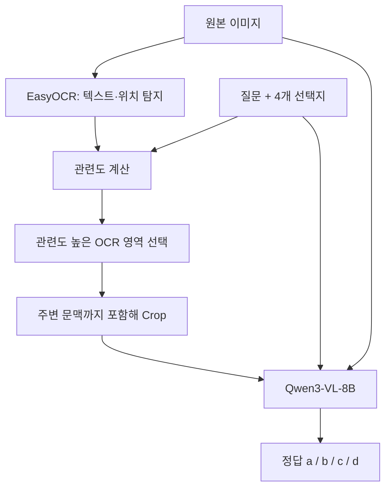

# Qwen3-VL 기반 VQA 성능 개선

**SSAFY 16기 AI Kaggle 경진대회 | Multimodal AI · Visual Question Answering**

이미지와 질문, 4개의 선택지가 주어졌을 때 정답을 고르는 VQA(Visual Question Answering) 프로젝트입니다. 제공된 베이스라인을 바탕으로 **Qwen3-VL-8B를 LoRA로 파인튜닝**하고, 여러 입력·추론 전략을 비교했습니다. 최종적으로 **질문과 관련된 이미지 영역을 강조하는 OCR Crop**과 **확신도가 낮은 예측만 교정하는 Choice-Permutation TTA**를 결합해 성능을 개선했습니다.

> **최고 Kaggle Public Score: `0.96127`**  
> V3 `0.95918` → FINAL2 `0.96127` (**+0.00209 / +0.209%p**)  
> 전체 Test 6,714개 중 **35개 예측만 변경**한 결과입니다.

[대회 페이지](https://www.kaggle.com/competitions/ssafy-16-2-ai-9-21-9-28) · **기술 스택:** Python, PyTorch, Qwen3-VL-8B, Transformers, PEFT/LoRA, EasyOCR, NumPy, Pandas, Google Colab

---

## 1. 문제 정의와 접근 방향

이 과제에서 모델은 **이미지의 시각적 정보**와 **질문·선택지의 의미**를 함께 이해해야 합니다. 특히 이미지 속 작은 문자나 숫자가 정답의 단서가 될 수 있고, 객관식에서는 선택지의 *내용*이 같아도 *배치 순서*에 따라 예측이 달라질 가능성이 있습니다.

실험 과정에서는 다음 세 가지 질문을 중심으로 개선 방향을 찾았습니다.

- **이미지를 더 크게 입력하면 정답률이 높아질까?** → 해상도 확대만으로는 개선되지 않았습니다.
- **이미지에서 읽어낸 OCR 텍스트를 모델에 주면 도움이 될까?** → 전체 OCR 텍스트를 프롬프트에 넣은 실험은 오히려 점수가 하락했습니다.
- **기존 모델의 모든 예측을 바꿀 필요가 있을까?** → 확신도가 낮고, 추가 추론이 뚜렷하게 다른 답을 지지하는 경우만 변경하는 전략을 선택했습니다.

따라서 모델 규모를 계속 키우기보다 **필요한 시각 정보를 잘 전달하는 방법**과 **기존 예측을 신중하게 보정하는 방법**에 집중했습니다.

## 2. 실험 과정: 어떤 방법을 비교했는가

| 실험 | 핵심 변경 | Kaggle Public Score | 판단 |
|:---|:---|---:|:---|
| V1 | Qwen3-VL-8B, 1024 visual tokens | 0.95770 | 초기 비교 기준 |
| V1.1 | visual tokens 1536으로 확대 | 0.95859 | 소폭 개선 |
| V2-A | visual tokens 2048로 확대 | 0.95770 | 추가 확대 효과 없음 |
| V2-B | 2048 + OCR 텍스트 직접 입력 | 0.95442 | 성능 하락 |
| **V3** | **1536 + Question-Aware OCR Crop** | **0.95918** | **최고 단일 모델** |
| V4 | V1.1 + V3 확률 앙상블 | 0.95740 | 성능 하락 |
| **FINAL2** | **V3 + Choice-Permutation TTA + Vote-Switch** | **0.96127** | **최종 최고 기록** |

다른 실험으로 OCR Crop 확대 방식, 분류 손실(4-way CE), 더 큰 Qwen 모델, 추가 파인튜닝 등도 탐색했습니다. 이 저장소에서는 **최고 결과를 만드는 데 직접 사용한 V3·FINAL2·FINAL3 노트북**을 중심으로 공개합니다.

**핵심 판단:** 단순히 더 많은 정보를 모델에 전달하는 것보다, **질문에 필요한 정보만 선별**하고 **불확실한 예측에만 추가 연산을 사용**하는 방식이 효과적이었습니다.

## 3. 핵심 개선 ① Question-Aware OCR Crop (V3)

### OCR 텍스트를 직접 넣는 대신, 이미지의 위치를 찾는 데 사용

V2에서는 EasyOCR로 읽은 문자열을 프롬프트에 추가했지만 Public Score가 `0.95442`로 하락했습니다. 그래서 V3에서는 OCR의 역할을 바꿨습니다. **OCR은 답변을 생성하는 대신 질문과 관련된 문자 영역을 찾는 도구**로만 사용합니다.



관련도를 계산할 때는 **질문·선택지와 OCR 문자열의 유사도**, **숫자 일치 여부**, **OCR 신뢰도**를 활용합니다. 관련도가 충분히 높은 영역이 있으면 주변까지 넓게 잘라 **원본 이미지 + Crop 이미지**를 함께 입력하고, 적절한 영역이 없으면 불필요한 Crop을 사용하지 않습니다.

이 접근은 작은 글씨를 강조하면서도 이미지 전체의 맥락을 유지하려는 시도였습니다. OCR 인식 문자열 자체는 Qwen 프롬프트에 넣지 않았습니다.

**V3 주요 설정**

| 항목 | 설정 |
|:---|:---|
| Base model | `Qwen/Qwen3-VL-8B-Instruct` |
| 입력 이미지 | 원본 + 관련 OCR Crop (선택적) |
| Visual token 상한 | 1536 |
| 파인튜닝 | BF16, LoRA (`r=16`, `alpha=32`) |
| 학습 | 2 epochs, Answer-only LM loss |
| 평가 | Dev의 다중 응답을 활용한 Consensus 등 |

이 구성의 **Public Score는 `0.95918`**로, 실험한 단일 모델 중 가장 좋았습니다.

## 4. 핵심 개선 ② Choice-Permutation TTA (FINAL2)

### 모델을 다시 학습하지 않고, 선택지 순서만 바꿔 재확인

V3의 모델 가중치는 유지한 채, 객관식 선택지의 **위치 편향 가능성**을 줄이는 방법을 시도했습니다. 원래 선택지 순서에 더해 3가지 순환 배치를 만들고, 각 추론 결과를 **원래 선택지 기준으로 되돌려** 비교했습니다.

| 추론 | a | b | c | d |
|:---|:---:|:---:|:---:|:---:|
| 원본 | A | B | C | D |
| Permutation 1 | B | C | D | A |
| Permutation 2 | C | D | A | B |
| Permutation 3 | D | A | B | C |

이렇게 하면 각 선택지가 `a/b/c/d` 위치에 한 번씩 등장하므로, 특정 위치를 선호하는 예측이 있다면 그 영향을 줄일 가능성이 있습니다.

다만 **6,714개 전체에 추가 추론을 적용하지는 않았습니다.** 기존 V3가 상위 두 선택지에 부여한 확률 차이인 **Confidence Margin**을 계산해, 상대적으로 확신이 낮은 문제만 대상으로 삼았습니다.

- 전체 Test: **6,714개**
- 추가 추론 대상: **130개** (약 1.94%)
- 문제당 추가 추론: **3회**, 총 **390회**

이 방식으로 계산량을 제한하면서, 바꿀 가치가 있는 예측에 집중했습니다.

## 5. 핵심 개선 ③ Vote-Switch: 확실한 경우에만 정답 변경

순서 변경 결과가 기존 예측과 다르다고 해서 무조건 답을 바꾸면, 원래 맞았던 문제까지 틀릴 수 있습니다. 그래서 **투표 합의도와 확률 차이를 함께 확인**하는 보수적인 규칙을 적용했습니다.

**기존 V3 답변을 변경하는 조건**

1. 3개 Permutation 결과 중 **2개 이상**이 같은 대안 답변을 선택한다.
2. 대안 답변과 기존 답변의 Permutation 평균 확률 차이가 **0.08 이상**이다.
3. 기존 V3의 Confidence Margin이 **0.50 이하**이다.

세 조건을 **모두 충족할 때만** 정답을 교체합니다.

그 결과 **6,714개 중 35개(약 0.52%)만 변경**한 `04_perm_vote_switch.csv` 제출에서 Public Score `0.96127`을 기록했습니다.

이후 **FINAL3**에서는 추가 학습이나 신규 추론 없이, 이미 생성한 캐시로 `최소 투표 수 × 확률 차이 × Margin 상한`의 **96개 규칙 조합**을 비교했습니다. 이는 최고 기록을 기준으로 한 *후속 규칙 탐색*이며, **`0.96127`을 넘는 점수가 확인되었다는 의미는 아닙니다.**

## 6. 결과 해석

| 비교 | Public Score | 변화 |
|:---|---:|---:|
| 초기 V1 | 0.95770 | 기준 |
| 최고 단일 모델 V3 | 0.95918 | V1 대비 +0.00148 |
| **최종 FINAL2** | **0.96127** | **V3 대비 +0.00209** |

이 실험에서 얻은 결과는 **작은 비율의 예측만 신중하게 수정해도 전체 제출 점수가 개선될 수 있다**는 것입니다. 특히 추가 학습 없이 이미 학습된 모델의 결과를 활용했다는 점에서, 후처리 전략의 효과를 확인할 수 있었습니다.

> **평가 범위:** 위 수치는 실험 노트북에 기록된 **Kaggle Public Leaderboard 점수**입니다. Dev의 Consensus 지표와는 다른 평가 결과이며, 공식 최종 순위나 Private Score를 나타내지 않습니다.

## 7. 시행착오를 통해 배운 점

**① 입력 정보는 많을수록 좋은 것이 아니었습니다.**  
Visual token을 1536에서 2048로 늘렸을 때 성능이 오르지 않았고, OCR 텍스트를 직접 추가한 실험에서는 오히려 하락했습니다. 이 결과를 바탕으로 이미지의 전체 문맥을 유지하되 **필요한 영역만 강조하는 입력 설계**로 방향을 바꿨습니다.

**② 모델 성능과 추론 전략을 분리해 생각하게 되었습니다.**  
V3 이후에는 가중치를 다시 학습하는 대신 선택지 순서를 변경하는 방법을 적용했습니다. 이를 통해 **모델을 교체하지 않고도 추론 과정의 설계로 결과를 개선**할 수 있음을 확인했습니다.

**③ 성능 개선과 변경 위험 사이의 균형이 중요했습니다.**  
TTA 결과가 다르다는 이유만으로 답을 바꾸지 않고, 투표 수·확률 차이·기존 모델의 확신도를 함께 활용했습니다. **얼마나 많은 예측을 바꾸느냐보다 어떤 예측을 바꾸느냐**에 집중한 전략이었습니다.

### 한계와 개선 가능성

- **Public Leaderboard 과적합 가능성:** 규칙 선택 과정에서 Public Score를 참고했으므로, 같은 개선이 비공개 평가에서도 유지되는지는 확인되지 않았습니다.
- **OCR 영역 선택 오류:** 관련도 기준에 따라 중요한 위치를 놓치거나 관련 없는 영역을 선택할 수 있습니다.
- **재현 환경 의존성:** 실험은 Google Colab·Drive와 별도 데이터/모델 캐시를 사용했으며, 현재 공개 저장소에는 가중치와 데이터가 포함되어 있지 않습니다.

## 8. 저장소 구성

```text
ssafy-vqa-qwen3vl/
├── README.md
├── requirements.txt
└── notebooks/
    ├── 01_v3_question_aware_ocr.ipynb   # LoRA 학습 + OCR Crop
    ├── 02_choice_permutation_tta.ipynb  # 선택지 순서 변경 추론 + Vote-Switch
    └── 03_vote_switch_analysis.ipynb    # 후처리 규칙 96개 조합 검증
```

### 실행 및 재현 참고

Google Colab GPU 환경에서 `requirements.txt`의 라이브러리를 설치한 뒤, **V3 → FINAL2 → FINAL3** 순으로 노트북을 실행하는 구조입니다. 대회 데이터, V3 LoRA 어댑터, 예측 CSV 및 Permutation 캐시는 별도 준비가 필요하며, 노트북의 Google Drive 경로를 실행 환경에 맞춰 수정해야 합니다. **이 저장소는 즉시 실행 가능한 배포 패키지가 아니라 실험 과정과 코드를 정리한 포트폴리오**입니다.

---

**핵심 정리:** Qwen3-VL의 입력을 개선하는 **Question-Aware OCR Crop**과, 불확실한 예측만 보정하는 **Choice-Permutation TTA + Vote-Switch**를 통해 Kaggle Public Score를 `0.95918 → 0.96127`로 개선했습니다.
